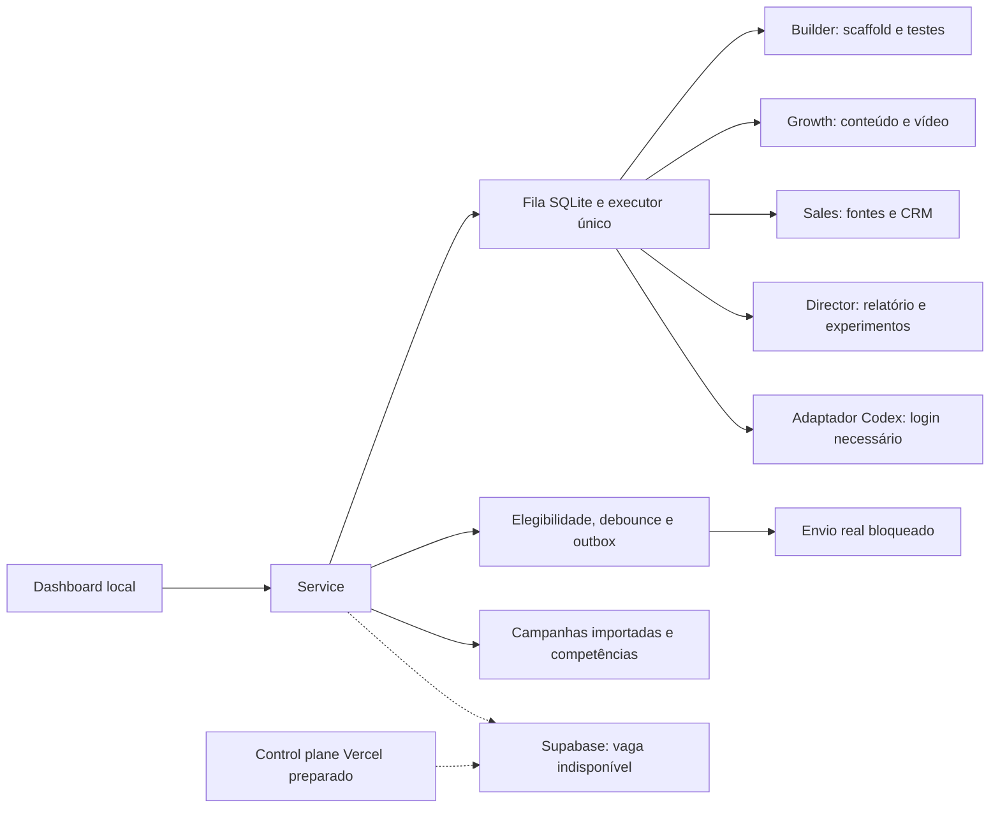

# Arquitetura V2.3

O executor Python preserva a fila transacional SQLite, locks de processo, prioridades, dependências, logs e checkpoints da V2.2. Não há quatro processos concorrentes nem inferência generativa conectada. Há quatro perfis e ferramentas locais coordenadas.

WhatsApp: o proprietário escolheu login manual por QR/código, sem API. O painel abre o WhatsApp Web oficial em outra aba. Não há ponte entre a sessão do navegador e o Sales. Status da sessão externa não é verificado, QR não é copiado e conversas não são capturadas. O histórico local tem eventos somente quando inseridos por ferramentas autorizadas de teste; o app não os apresenta como sincronização WhatsApp.

A máquina de respostas agrupa mensagens de uma conversa por janela 3–10s. Revisões invalidam gerações anteriores, a outbox tem chave única e leases de geração. Takeover incrementa a revisão e cancela pendências. Falhas de geração têm limite; efeitos externos ambíguos exigem reconciliação. Nenhum resultado local comprova a corrida de cancelamento de um provedor real; mensagens já aceitas por uma plataforma não podem ser recolhidas por esse mecanismo.

O ramo de envio com fixture só funciona quando a instância é explicitamente marcada simulation_only. A API não expõe esse ajuste e o processo de produção bloqueia todos os envios sem transporte. Há uma implantação pendente, não um conector genérico declarado conectado.

Banco cloud: migração preparada com owner_id, Auth, RLS e claim SECURITY INVOKER. `SupabaseStore.sync` envia todos os registros por upsert com JWT do usuário. Não faz sincronização bidirecional, não propaga exclusões e não liga automaticamente a fila cloud à fila local.

Execução com notebook desligado requer host persistente. As units em `deploy/` são um plano executável de instalação para Linux, ainda sem host/teste real. Vercel hospeda o control plane preparado; não substitui esse worker. Nenhum servidor foi contratado ou publicado nesta evolução.
